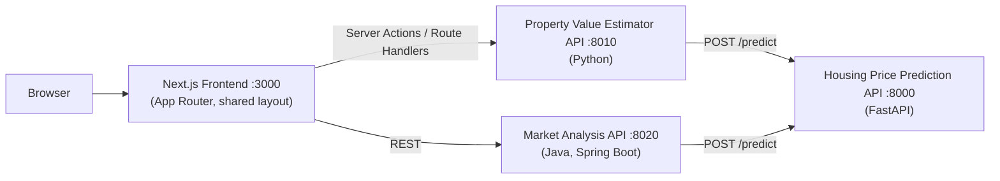

# property-value-system

A full-stack Property Value System project: a containerised regression model that predicts housing prices, and a unified Next.js portal hosting two independent applications, each backed by a different technology (Python and Java), both consuming the ML model.

| Part                         | What it is                                  | Stack                                 |
| ---------------------------- | ------------------------------------------- | ------------------------------------- |
| Housing Price Prediction API | Regression model served over HTTP           | Python, FastAPI, scikit-learn         |
| Property Value Estimator     | Estimate form, results, history, comparison | Next.js + Python backend              |
| Property Market Analysis     | Market dashboard, filters, what-if, export  | Next.js + Java 21 / Spring Boot 4.0.8 |

## Architecture



## Repository structure

```
.
├── apps/
│   ├── housing-price-prediction/   # FastAPI + scikit-learn model API
│   ├── property-value-estimator/   # App 1 backend (Python)
│   ├── property-market-analysis/   # App 2 backend (Java 21, Spring Boot)
│   └── front-end/                     # Next.js frontend
├── data/                           # Training and testing data sets for ML
├── models/                         # Trained model artifact(s) loaded by the ML API
├── notebooks/                         # ML notebook
├── pyproject.toml                  # uv workspace root
├── uv.lock
└── docker-compose.yml
```

## Tech stack

**Frontend:** Next.js (App Router), React, TypeScript, Tailwind CSS, Zod, Zustand, SWR, Recharts, Lucide icons

**Python services:** Python 3.12+, FastAPI, scikit-learn, uv (workspace and lockfile management)

**Java service:** Java 21, Spring Boot 4.0.8

**Infrastructure:** Docker, Docker Compose (user-defined bridge network with health-checked dependencies)

## Getting started

### Prerequisites

- Docker and Docker Compose v2
- For running without Docker: Python 3.12+, [uv](https://docs.astral.sh/uv/), Java 21, Node.js 20+

### Run everything with Docker Compose

```bash
docker compose up --build -d
```

| Service                      | URL                                           |
| ---------------------------- | --------------------------------------------- |
| Frontend (Next.js)           | http://localhost:3000                         |
| Housing Price Prediction API | http://localhost:8000 · Swagger UI at `/docs` |
| Property Value Estimator API | http://localhost:8010                         |
| Market Analysis API          | http://localhost:8020                         |

## Features

### App 1: Property Value Estimator

- **Estimate form** covering all model fields, with client- and server-side validation and per-field error messages
- **Results** shown as a table and as a bar chart of estimated values
- **History** of previous estimates, kept in a global store
- **Comparison view** to analyse multiple properties side by side

### App 2: Property Market Analysis

- **Interactive dashboard** with market visualisations
- **Filters** for analysing property segments (price, bedrooms, year built, square footage, school rating)
- **What-if analysis** that re-prices a selected property after changing its attributes
- **CSV and PDF export** of the filtered, sorted table
- **Responsive tables** with sorting and filtering
- **Backend**: aggregate statistics from the housing dataset, ML integration, and response caching

## Validation rules

Enforced on the server with Zod, with matching native constraints in the UI:

| Field                   | Rule                                              |
| ----------------------- | ------------------------------------------------- |
| Square footage          | Positive integer                                  |
| Bedrooms                | Positive integer                                  |
| Bathrooms               | Positive, in steps of 0.5                         |
| Year built              | Integer, 1800 up to the current year              |
| Lot size                | Positive integer, **at least the square footage** |
| Distance to city center | Positive number                                   |
| School rating           | Positive number                                   |
